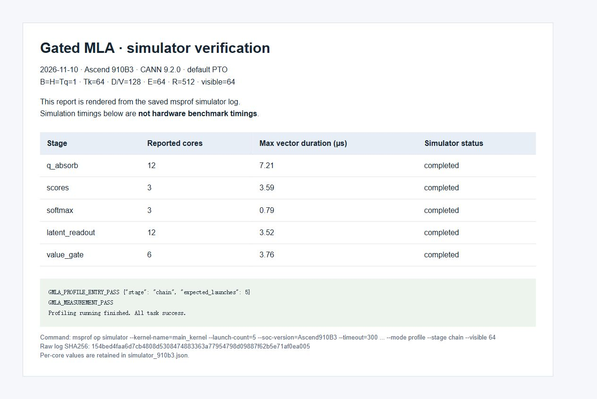

# Gated MLA decode: validation and performance

## Scope and environment

Measured on 2026-11-10: Ascend 910B3, CANN 9.2.0, Python 3.12.9,
PyTorch 2.7.1+cpu with torch_npu 2.7.1.post4, and TileLang runtime
`cc9e2681c17c7a8479e2ec9b3b91124fca819c69`. The public API defaults to PTO;
AscendC is explicitly selectable. Shapes and finite-input limits are in [README.md](README.md).
This is an experimental fixed-domain decode example, not full-model integration.

[Test counts, source hashes and hardware samples](tools/benchmark/results/validation_910b3.json),
[full-chain samples](tools/benchmark/results/full_chain_910b3.json), and
[attention-core samples](tools/benchmark/results/attention_core_910b3.json) accompany this report.

## Correctness and test lanes

| Lane | Result | Elapsed time |
|---|---|---:|
| Core, new empty JIT cache | 27 passed, 0 skipped | 122.90 s |
| Extended, same cache | 4 passed, 0 skipped | 28.52 s |

Default-PTO tests retain full-chain, partial-prefix, 1/17/63/64 readout, device
negative-infinity mask, gate, empty-query, contract rejection and input-read-only
regressions. Explicit AscendC partial-prefix and empty-query tests remain in the
core lane. Only the four non-core combinations use `low_priority`; no `ci_skip` is used.
The core is slightly over two minutes: the template's documented core/extended
split is used, without hiding key regressions or claiming a sub-two-minute result.

Both full-chain compositions pass 5 seeds x visible lengths 1/17/64 against FP64
references. The new core benchmark checks 30 query-policy/seed/prefix combinations
for both candidate and FIA. FP16 acceptance is `rtol=1e-2`, `atol=2e-3`, and maximum
amplitude-normalized error <= `5e-3`; the FP32 core output additionally uses
`rtol=1e-3`, `atol=5e-5`. These are tested synthetic-domain budgets, not arbitrary-input
error guarantees. Hosted CI is a separate validation of the submitted commit.

## Baseline boundaries and protocol

CANN `torch_npu.npu_fused_infer_attention_score_v2` is the official attention core.
The **full-chain FIA composition** adds query absorption, value restoration and
sigmoid gate to match the seven-input Gated MLA interface. It is not a standalone,
same-interface official fused Gated MLA operator.

The **independent attention-core** comparison excludes those projections and gate
on both sides. It uses precomputed absorbed-query values, shared caches, the same
scale `1/sqrt(192)` and the same visible prefix. `matched_fp16_query` matches input
values, not precision: the candidate stores them in FP32 and returns FP32; FIA
receives and returns FP16. `native_fp32_query` records the extra FIA query rounding.
The FP64 core reference is independent; it does not reuse candidate outputs.

All times below are microseconds. Eager diagnostics use 10 warmups and 20 Event
samples; the Event interval includes device idle gaps caused by host dispatch.
Graph diagnostics capture 50 calls, warm up 5 replays, measure 20 replays and divide
by 50. Inputs/weights are reused without L2 flushing; compilation and accuracy checks
precede timing. Input conversion, H2D copies, block-table setup and cache views are
outside core timing; FIA's output zero-copy view remains inside its call. Each method's
normal allocations and dispatch remain included.

`msprof op` hardware Task Duration and simulator durations are separate evidence.
Individual stage samples are not summed or represented as a complete-chain latency.
Before/after runs are separate measurements, not interleaved statistical trials.

## Final default-PTO results

| Visible keys | PTO full-chain graph | FIA composition graph | PTO full-chain eager | FIA composition eager |
|---:|---:|---:|---:|---:|
| 64 | 34.29 | 28.65 | 986.40 | 1007.98 |
| 17 | 35.02 | 27.25 | 1010.76 | 993.72 |

The graph throughput ratios `T_FIA / T_candidate` are 83.5% and 77.8% for these
representative fixed-domain prefixes. This comparison is limited to the stated
precision and timing paths; no GPU measurement or wider shape claim is made.

| Visible keys | PTO attention-core graph | FIA attention-core graph | PTO core eager | FIA core eager |
|---:|---:|---:|---:|---:|
| 64 | 18.10 | 15.29 | 629.24 | 338.18 |
| 17 | 18.65 | 13.84 | 618.96 | 339.37 |

This table uses matched FP16-representable query values. It is the attention core,
not the complete Gated MLA interface. Both query policies and every raw timing sample
are retained in the linked JSON report.

Independent `msprof op` runs used the same matched query values and observed three
PTO launches versus one physical FIA kernel. These are individual Task Duration
samples, not sums or substitutes for the repeated graph measurements:

| Visible keys | PTO score / softmax / readout | FIA kernel |
|---:|---:|---:|
| 64 | 7.04 / 4.88 / 7.38 | 20.44 |
| 17 | 7.56 / 4.86 / 6.96 | 17.84 |

[Hardware core names and samples](tools/benchmark/results/attention_core_hardware_910b3.json)
record the actual launches; the FIA profiler command used no custom-kernel filter.

## Score optimization and runtime attribution

The score kernel replaces eight `[32,64]` load/cast/reduce/accumulate iterations
with one `[32,512]` tile per AIV. Explicit UB buffers occupy 113280 bytes; compilation,
real-NPU accuracy and simulator checks passed. FP32 summation order changes and is
revalidated. The prefix readout retains its contiguous tail `T.tile.fill`.

The following development comparison uses **AscendC on the same cc9e268 runtime**.
It is not presented as the default-PTO result above.

| Visible keys | Score hardware Task Duration before | After | Full-chain graph before | After |
|---:|---:|---:|---:|---:|
| 64 | 11.54 | 6.76 | 36.46 | 30.90 |
| 17 | 12.02 | 7.34 | 36.57 | 30.95 |

The score-stage hardware reductions are 41.4% and 38.9%. The optimization candidate
passed all original 29 tests before integrating the public backend API.
Separately, upgrading runtime 463c234 to cc9e268 includes upstream
[#1948](https://github.com/tile-ai/tilelang-ascend/pull/1948)'s lazy Analyzer construction:
the unchanged five-stage AscendC chain's eager medians changed from 2884.95/2970.85
to 1240.74/1314.45. That improvement belongs to the runtime upgrade, not this operator PR.

## Simulator evidence

The final default-PTO five-stage chain completed on the Ascend910B3 simulator with
`GMLA_PROFILE_ENTRY_PASS`, `GMLA_MEASUREMENT_PASS`, and all five profiling tasks successful.
The tool warned that source-line call stacks were unavailable because the kernels
were not built with debug-line information; this did not prevent execution or timing.



This screenshot shows a report rendered from the actual saved simulator log,
not the MindStudio GUI. [Per-core simulator values and log hash](tools/benchmark/results/simulator_910b3.json)
are retained; simulation durations must not be substituted for real-device performance.

## Reproduce

From a built checkout with CANN, PTO and torch_npu dependencies:

```bash
python -m pytest examples_experiment/gated_mla/test_gated_mla_decode.py -q -m 'not (low_priority or ci_skip)'
python -m pytest examples_experiment/gated_mla/test_gated_mla_decode.py -q -m low_priority
python examples_experiment/gated_mla/tools/benchmark/measure_decode.py --warmup 10 --repeats 20 --graph-batch 50 --output /tmp/gmla_full_new
python examples_experiment/gated_mla/tools/benchmark/measure_attention_core.py --output /tmp/gmla_core_new
msprof op --kernel-name=main_kernel --launch-count=5 --output=/tmp/gmla_hw_new python examples_experiment/gated_mla/tools/benchmark/measure_decode.py --mode profile --stage chain --visible 64 --output /tmp/gmla_hw_entry_new
msprof op simulator --kernel-name=main_kernel --launch-count=5 --soc-version=Ascend910B3 --timeout=300 --output=/tmp/gmla_sim_new python examples_experiment/gated_mla/tools/benchmark/measure_decode.py --mode profile --stage chain --visible 64 --output /tmp/gmla_sim_entry_new
```

The core benchmark also supports `--mode profile --method tilelang_attention` or
`cann_fia_attention`, `--query-policy matched_fp16_query`, and `--visible 17`.
For FIA hardware profiling omit the custom `main_kernel` filter; inspect actual physical
launches rather than assuming one API call means one device kernel. Use new output
directories each time. An independent worktree may point pytest `pythonpath` at its
same-revision built runtime; candidate/tests must still load from that worktree.

Remaining scope: no long cache, multi-head/batch, prefill, quantization, backward,
GPU parity, or production model integration. The experimental-directory placement
and merge decision remain subject to maintainer review.
