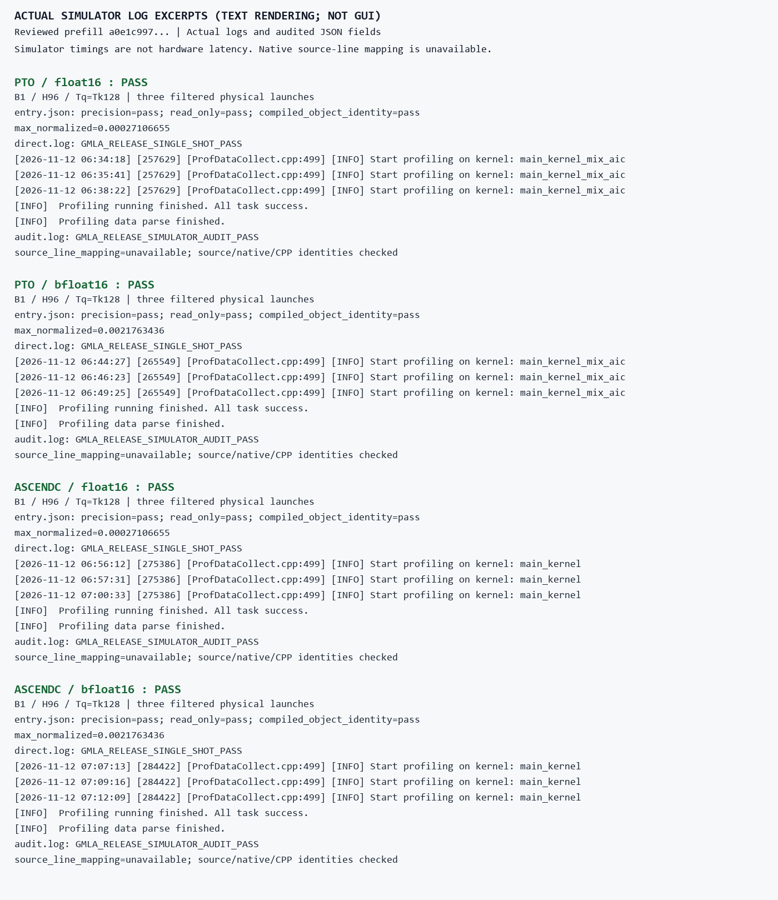

# Reviewed prefill simulator evidence (2026-11-12)

This matrix uses reviewed prefill source `a0e1c997ea1204ea12f508311fe4d584f2274585198503c322259c5de0abc2c0`, the normal package route, B1/H96/Tq=Tk128, PTO/AscendC and FP16/BF16. All four prepare/direct/simulator/audit sequences passed the original FP64 budgets and readonly checks. Each audit found exactly three physical launches: query absorption (including BF16 residual), attention and value/gate.

The 25 production-source fingerprints match the tested revision. Generated CPP for all three stages matches formal full-chain trial0 for the same dtype/backend; prepare, direct and simulator also have identical source/native/CPP identities. Formal performance JSON does not contain per-library native hashes, so no formal-trial native-hash match is claimed.

The unchanged tools retain a historical `r1.7` label; the explicit source fingerprints identify this reviewed prefill revision. Full raw traces remain in the retained private simulator evidence. The [compact matrix](PREFILL_SIMULATOR_20261112.json) includes source/CPP/native identities and raw-file/log digests without the large artifact inventory or private installation paths.

|Backend|dtype|Precision / readonly|Physical launches|Source-line mapping|
|---|---|---|---:|---|
|pto|float16|pass / pass|3|unavailable|
|pto|bfloat16|pass / pass|3|unavailable|
|ascendc|float16|pass / pass|3|unavailable|
|ascendc|bfloat16|pass / pass|3|unavailable|

## Actual log excerpts rendered as text



The image renders actual log excerpts and audited JSON fields; it is not a MindStudio GUI screenshot. Simulator timings are not hardware performance. Native source-line mapping is unavailable because debug-line information was missing; successful launch/precision/audit checks do not establish that mapping. The filtered launch trace is not a whole-process trace.

In a built compatible TileLang/CANN environment, reproduce using:

```bash
python validation/reproduce.py --package-root <current-package> --output <new-output-directory> --case prefill --target all --dtype all
```

Expect four sequences and inspect each audit JSON, precision/readonly result, source fingerprints and generated CPP; exit status alone is insufficient. Simulator wall duration is orchestration time and is not reported as hardware latency.
