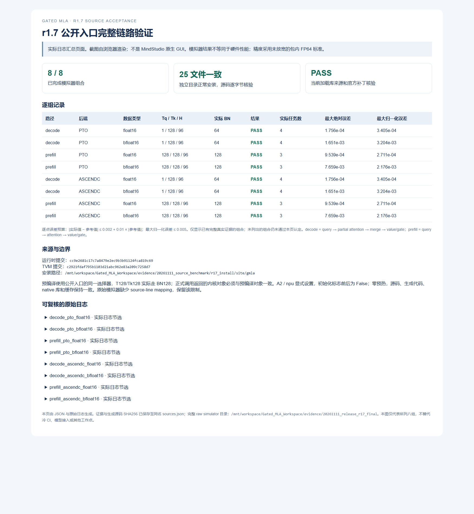

# Reproduce a representative r17 direct/simulator case

Required files: `reproduce.py`, `release_entry.py`, `audit_simulator.py`, `bounded_process.py`, and this README. No private environment script, native binary, old build hash, browser profile or large instruction dump is required.

Activate your own compatible Linux A2 CANN/TileLang/PyTorch environment first. `--package-root` names the directory containing this PR's `gmla/` package, or a normal installed site directory. Use a new output directory:

```bash
python reproduce.py --package-root /path/to/package --output /new/path/evidence \
  --case prefill --target pto --dtype float16
```

`--case decode` uses B1/H96/Tq1/Tk128. `prefill` uses B1/H96/Tq128/Tk128 and follows the public BN128 selector. `--case all --target all --dtype all` selects the eight representative combinations; `--direct-only` omits simulation. Device defaults to0, simulator SoC toAscend910B3. This is an explicitly A2-scoped example, not an automatic multi-platform fallback.

Prepare runs outside capture and records the **current host's** production, generated-kernel, loaded-native-library and isolated-cache identity. It checks NPU initialization remains false. Direct and simulator calls each use public `runtime.forward` once, verify FP64 accuracy/read-only inputs, and require exactly the prepared kernel objects/configuration. No historical author-specific binary hash is imposed. Prepare and execution should run on the same node/interpreter; CPU-node manifests are not silently reused on a different NPU node.

The installed SDK defines `msprof op simulator --timeout` in **minutes**. This wrapper uses15minutes and an outer900-second job deadline. It creates a private process session and records descendants/start ticks so timeout cleanup targets only verified job-owned processes, including observed descendants with separate groups. Failures stop the run and retain logs; no hardware reset or automatic retry is performed.

`simulator_audit.json` requires precision success, complete simulator finish markers and the actual4(decode)/3(prefill) filtered main-kernel launches. These simulator results do not constitute hardware performance. Missing source-line mapping remains an explicit limitation. To reproduce the historical reported run exactly, consult its preserved command: that run used SDK `--timeout=600` minutes plus the same outer900-second bound. **This new portable wrapper did not execute that historical matrix.**

## Recorded result

The [matrix summary](simulator_matrix.json) records eight completed direct/simulator combinations and their generated-kernel hashes. The image is a browser rendering of the actual log summary, not the MindStudio GUI. Source-line mapping was unavailable.


